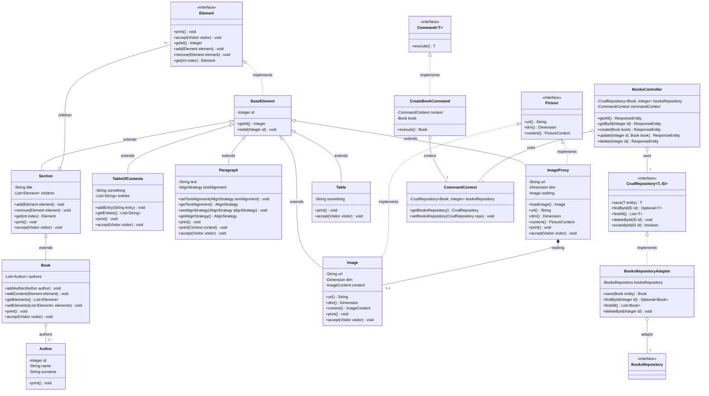

# Bookish - Design Patterns & Clean Architecture

## 1. Project Overview
**Bookish** is a modular document and book management platform inspired by cloud storage services (like Google Drive). The goal of the project is to build an extensible, maintainable system applying **Design Patterns**, **SOLID principles**, and **Clean Code** practices.

The milestones cover hierarchical document modeling (Composite), dynamic text formatting (Strategy), lazy media resource loading (Proxy), extensible document traversal (Visitor), Spring Data JPA persistence with polymorphic entity hierarchy, data access abstraction (Adapter), and request encapsulation (Command).

---

## 2. Architectural Design

### 2.1 The Composite Pattern
The document structure follows the Gang of Four (GoF) **Composite Pattern** (transparent variant). This allows clients to treat individual content elements and compositions of elements uniformly.

### 2.2 The Strategy Pattern
Text alignment follows the GoF **Strategy Pattern**. A `Paragraph` delegates its rendering to an `AlignStrategy` (`AlignLeft`, `AlignRight`, or `AlignCenter`), with an optional `Context` (representing parameters such as characters per page).

### 2.3 The Proxy Pattern
Image loading follows the GoF **Proxy Pattern** (Virtual Proxy variant). An `ImageProxy` stands in for an `Image` object implementing the common `Picture` interface. Heavy real image instances are only instantiated lazily on demand when `loadImage()`, `print()`, or `content()` is accessed.

### 2.4 The Visitor Pattern
Document traversal and operations follow the GoF **Visitor Pattern**. Each `Element` declares `accept(Visitor)`, enabling new operations to be added without modifying the element classes:
- **`RenderContentVisitor`**: Traverses the document structure to print and format elements.
- **`BookStatistics`**: Accumulates element counts (paragraphs, images, tables, sections, books) and provides `printStatistics()`.
- **`GenerateToC`**: Extracts section titles into a `TableOfContents` accessible via `getToC()`.

### 2.5 The Adapter Pattern
Persistence abstraction follows the GoF **Adapter Pattern**. Instead of tightly coupling controllers and command services directly to Spring Data's `BooksRepository`, an abstraction interface [`CrudRepository`](file:///D:/Lucian/Java/Bookish/src/main/java/org/sp/bookish/persistence/CrudRepository.java) sits in between, implemented via [`BooksRepositoryAdapter`](file:///D:/Lucian/Java/Bookish/src/main/java/org/sp/bookish/persistence/BooksRepositoryAdapter.java) and [`AuthorsRepositoryAdapter`](file:///D:/Lucian/Java/Bookish/src/main/java/org/sp/bookish/persistence/AuthorsRepositoryAdapter.java).

### 2.6 The Command Pattern
Business operations triggered by controllers follow the GoF **Command Pattern**. Each request encapsulates execution logic inside command objects (`CreateBookCommand`, `GetAllBooksCommand`, `GetBookByIdCommand`, `UpdateBookCommand`, `DeleteBookCommand`) with state shared via [`CommandContext`](file:///D:/Lucian/Java/Bookish/src/main/java/org/sp/bookish/commands/CommandContext.java).



---

## 3. Package & Class Structure

### 3.1 Domain Entity Package (`org.sp.bookish.entity`)

| Class / Interface | Role in Pattern | Description |
| :--- | :--- | :--- |
| [`Element`](file:///D:/Lucian/Java/Bookish/src/main/java/org/sp/bookish/entity/Element.java) | **Component** | Declares common interface for all components in the document tree (`print()`, `accept()`, `getId()`, `add()`, `remove()`, `get()`). Default methods throw `UnsupportedOperationException` for leaf elements. |
| [`BaseElement`](file:///D:/Lucian/Java/Bookish/src/main/java/org/sp/bookish/entity/BaseElement.java) | **Entity Superclass** | Root entity for JPA `JOINED` inheritance hierarchy, holds primary key `@Id @GeneratedValue(strategy = GenerationType.IDENTITY)`. |
| [`Section`](file:///D:/Lucian/Java/Bookish/src/main/java/org/sp/bookish/entity/Section.java) | **Composite & Entity** | Represents a structured section with title and child elements mapped via `@OneToMany(targetEntity = BaseElement.class, cascade = CascadeType.ALL)`. |
| [`Paragraph`](file:///D:/Lucian/Java/Bookish/src/main/java/org/sp/bookish/entity/Paragraph.java) | **Leaf & Entity** | Holds text and transient `AlignStrategy`. |
| [`Picture`](file:///D:/Lucian/Java/Bookish/src/main/java/org/sp/bookish/entity/Picture.java) | **Subject Interface** | Common interface extending `Element` for images and proxies. |
| [`Image`](file:///D:/Lucian/Java/Bookish/src/main/java/org/sp/bookish/entity/Image.java) | **Real Subject & Entity** | Real image resource with url and embedded dimension. |
| [`ImageProxy`](file:///D:/Lucian/Java/Bookish/src/main/java/org/sp/bookish/entity/ImageProxy.java) | **Proxy & Entity** | Virtual proxy that defers loading of `Image` with transient `realImg`. |
| [`Dimension`](file:///D:/Lucian/Java/Bookish/src/main/java/org/sp/bookish/entity/Dimension.java) | **Embeddable Value Object** | Holds 2D image dimensions (`width`, `height`). |
| [`PictureContent`](file:///D:/Lucian/Java/Bookish/src/main/java/org/sp/bookish/entity/PictureContent.java) | **Content Model** | Base class representing picture content. |
| [`ImageContent`](file:///D:/Lucian/Java/Bookish/src/main/java/org/sp/bookish/entity/ImageContent.java) | **Content Model** | Specific content payload for images. |
| [`Table`](file:///D:/Lucian/Java/Bookish/src/main/java/org/sp/bookish/entity/Table.java) | **Leaf & Entity** | Tabular data element persisted in `@Table(name = "book_tables")`. |
| [`TableOfContents`](file:///D:/Lucian/Java/Bookish/src/main/java/org/sp/bookish/entity/TableOfContents.java) | **Leaf & Entity** | Document table of contents with element collection entries. |
| [`Book`](file:///D:/Lucian/Java/Bookish/src/main/java/org/sp/bookish/entity/Book.java) | **Composite & Root Entity** | Extends `Section`, contains authors mapped via `@ManyToMany(cascade = CascadeType.ALL)`. |
| [`Author`](file:///D:/Lucian/Java/Bookish/src/main/java/org/sp/bookish/entity/Author.java) | **Entity** | Holds author identity (`name`, `surname`) and generated ID. |

### 3.2 Strategy Package (`org.sp.bookish.strategy`)

| Class / Interface | Role in Pattern | Description |
| :--- | :--- | :--- |
| [`AlignStrategy`](file:///D:/Lucian/Java/Bookish/src/main/java/org/sp/bookish/strategy/AlignStrategy.java) | **Strategy Interface** | Defines the contract for alignment rendering: `render(Paragraph, Context)`. |
| [`AlignLeft`](file:///D:/Lucian/Java/Bookish/src/main/java/org/sp/bookish/strategy/AlignLeft.java) | **Concrete Strategy** | Left alignment rendering strategy. |
| [`AlignRight`](file:///D:/Lucian/Java/Bookish/src/main/java/org/sp/bookish/strategy/AlignRight.java) | **Concrete Strategy** | Right alignment rendering strategy. |
| [`AlignCenter`](file:///D:/Lucian/Java/Bookish/src/main/java/org/sp/bookish/strategy/AlignCenter.java) | **Concrete Strategy** | Center alignment rendering strategy. |
| [`Context`](file:///D:/Lucian/Java/Bookish/src/main/java/org/sp/bookish/strategy/Context.java) | **Strategy Context** | Context object holding configuration such as `charactersPerPage`. |

### 3.3 Visitor Package (`org.sp.bookish.visitor`)

| Class / Interface | Role in Pattern | Description |
| :--- | :--- | :--- |
| [`Visitor`](file:///D:/Lucian/Java/Bookish/src/main/java/org/sp/bookish/visitor/Visitor.java) | **Visitor Interface** | Contract defining `visit(...)` methods for all element types. |
| [`RenderContentVisitor`](file:///D:/Lucian/Java/Bookish/src/main/java/org/sp/bookish/visitor/RenderContentVisitor.java) | **Concrete Visitor** | Traverses elements to render/print them cleanly. |
| [`BookStatistics`](file:///D:/Lucian/Java/Bookish/src/main/java/org/sp/bookish/visitor/BookStatistics.java) | **Concrete Visitor** | Collects statistics (counts of paragraphs, images, tables) and displays them via `printStatistics()`. |
| [`GenerateToC`](file:///D:/Lucian/Java/Bookish/src/main/java/org/sp/bookish/visitor/GenerateToC.java) | **Concrete Visitor** | Extracts section titles with dynamic page numbering (1 page per visited element) and builds a `TableOfContents` accessible via `getToC()`. |

### 3.4 Persistence Package (`org.sp.bookish.persistence`)

| Class / Interface | Role in Pattern | Description |
| :--- | :--- | :--- |
| [`BooksRepository`](file:///D:/Lucian/Java/Bookish/src/main/java/org/sp/bookish/persistence/BooksRepository.java) | **Spring Data Repository (Adaptee)** | Spring Data JPA repository for persisting `Book` and the whole `BaseElement` hierarchy. |
| [`AuthorsRepository`](file:///D:/Lucian/Java/Bookish/src/main/java/org/sp/bookish/persistence/AuthorsRepository.java) | **Spring Data Repository (Adaptee)** | Spring Data JPA repository for `Author` entities. |
| [`AuthorRepository`](file:///D:/Lucian/Java/Bookish/src/main/java/org/sp/bookish/persistence/AuthorRepository.java) | **Spring Data Repository** | Extended alias for `AuthorsRepository`. |
| [`CrudRepository`](file:///D:/Lucian/Java/Bookish/src/main/java/org/sp/bookish/persistence/CrudRepository.java) | **Target Interface** | Clean persistence abstraction interface for upper layers (`save`, `findById`, `findAll`, `deleteById`, `existsById`). |
| [`BooksRepositoryAdapter`](file:///D:/Lucian/Java/Bookish/src/main/java/org/sp/bookish/persistence/BooksRepositoryAdapter.java) | **Adapter** | Adapts Spring Data `BooksRepository` to `CrudRepository<Book, Integer>`. |
| [`AuthorsRepositoryAdapter`](file:///D:/Lucian/Java/Bookish/src/main/java/org/sp/bookish/persistence/AuthorsRepositoryAdapter.java) | **Adapter** | Adapts Spring Data `AuthorsRepository` to `CrudRepository<Author, Integer>`. |

### 3.5 Commands Package (`org.sp.bookish.commands`)

| Class / Interface | Role in Pattern | Description |
| :--- | :--- | :--- |
| [`Command`](file:///D:/Lucian/Java/Bookish/src/main/java/org/sp/bookish/commands/Command.java) | **Command Interface** | Generic command interface declaring `T execute()`. |
| [`CommandContext`](file:///D:/Lucian/Java/Bookish/src/main/java/org/sp/bookish/commands/CommandContext.java) | **Command Context** | Shared context holding repository dependencies for command execution. |
| [`CreateBookCommand`](file:///D:/Lucian/Java/Bookish/src/main/java/org/sp/bookish/commands/CreateBookCommand.java) | **Concrete Command** | Encapsulates creating and persisting a new `Book`. |
| [`GetAllBooksCommand`](file:///D:/Lucian/Java/Bookish/src/main/java/org/sp/bookish/commands/GetAllBooksCommand.java) | **Concrete Command** | Encapsulates retrieving all books. |
| [`GetBookByIdCommand`](file:///D:/Lucian/Java/Bookish/src/main/java/org/sp/bookish/commands/GetBookByIdCommand.java) | **Concrete Command** | Encapsulates finding a book by ID. |
| [`UpdateBookCommand`](file:///D:/Lucian/Java/Bookish/src/main/java/org/sp/bookish/commands/UpdateBookCommand.java) | **Concrete Command** | Encapsulates updating an existing book. |
| [`DeleteBookCommand`](file:///D:/Lucian/Java/Bookish/src/main/java/org/sp/bookish/commands/DeleteBookCommand.java) | **Concrete Command** | Encapsulates deleting a book by ID. |

### 3.6 Controllers & Dependency Injection (`org.sp.bookish.controllers`, `org.sp.bookish.difexample`)

| Class / Interface | Role in Pattern | Description |
| :--- | :--- | :--- |
| [`BooksController`](file:///D:/Lucian/Java/Bookish/src/main/java/org/sp/bookish/controllers/BooksController.java) | **REST Controller** | Exposes REST endpoints (`/books`, `/books/{id}`) mapping HTTP verbs to commands. |
| [`HelloController`](file:///D:/Lucian/Java/Bookish/src/main/java/org/sp/bookish/controllers/HelloController.java) | **REST Controller** | Exposes root endpoint (`/`) and demonstrates constructor injection of `SingletonComponent`. |
| [`SingletonComponent`](file:///D:/Lucian/Java/Bookish/src/main/java/org/sp/bookish/difexample/SingletonComponent.java) | **Singleton Component** | Spring `@Component` representing a singleton bean managed by the Spring DI container. |

---

## 4. Design Decisions

1. **JPA Joined Table Inheritance**:
   - `BaseElement` serves as the root `@Entity` with `InheritanceType.JOINED`. Derived classes (`Section`, `Book`, `Paragraph`, `Table`, `Image`, `ImageProxy`, `TableOfContents`) keep dedicated tables cleanly joined to `BaseElement`.
2. **Transparent Composite Persistence**:
   - Composite collections (`Section.children`) use `@OneToMany(targetEntity = BaseElement.class, cascade = CascadeType.ALL)` to persist nested document trees recursively.
3. **Lazy Proxy Handling & Serialization Protection**:
   - `@JsonIgnoreProperties({"hibernateLazyInitializer", "handler"})` prevents Jackson serialization errors on Hibernate ByteBuddy proxies.
   - Virtual proxy fields like `ImageProxy.realImg` and `Paragraph.textAlignment` are `@Transient` and `@JsonIgnore` to prevent premature instantiation or mapping errors.
4. **Adapter Pattern for Repository Abstraction**:
   - Controller and Command layers depend on `CrudRepository` rather than concrete Spring Data interfaces, enabling decoupling and pluggable storage backends.
5. **Command Pattern for Controller Request Handling**:
   - Each endpoint instantiates and executes a command passing `CommandContext`, keeping controllers lightweight and actions testable and modular.

---

## 5. Usage Example

```java
// Saving a composite book with authors and nested sections
Book book = new Book("Clean Architecture");
Author author = new Author("Robert", "Martin");
book.addAuthor(author);

Section section = new Section("Part 1: Introduction");
section.add(new Paragraph("Architecture overview."));
section.add(new ImageProxy("architecture.png", new Dimension(800, 600)));
book.add(section);

// Via Command pattern & Repository adapter
CommandContext context = new CommandContext(booksRepositoryAdapter);
CreateBookCommand createCmd = new CreateBookCommand(context, book);
Book savedBook = createCmd.execute();
```

---

## 6. Future Roadmap

- **REST Controller & Drive Services**: Uploading, organizing, and versioning documents in a Google Drive-like API.
